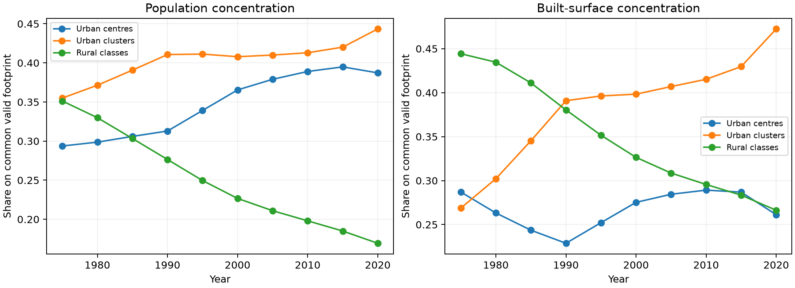

# GHSL urban concentration and growth

This project combines GHSL population, built-up surface (total and non-residential),
and settlement classes to study urban concentration and settlement growth.

The analysis covers **13 tiles across 12 epochs (1975–2030)**, or 156 tile-year jobs.
Data for 1975–2020 are historical, 2025 and 2030 are projections and are treated
separately. Tile R8_C27 is excluded because no valid analytical cells were found
within the selected country mask, including after fresh-source retries.
**The results do not cover all of India.**

## Documentation

- [Reproduction guide](REPRODUCTION.md)

## Results

- Integrated 624 validated source archives, retaining native 100 m values with
  matching-year 1 km settlement classes.
- Analysed 3,280,884 coarse cells with complete data across ten transition periods.
- Produced district summaries with population/value conservation checks and
  explicit categories for unmatched cells and overlapping districts.
- Identified 108,804 candidate events across periods. Events can overlap and are
  not counts of unique or confirmed towns.

See the [completion report](analysis/data/final_results/REPORT.md) and
[regional validation report](phase3/reports/regional_validation/REPORT.md) for detailed
results and checks.

## Project structure

| Folder | Contents |
|---|---|
| `population/` | Ingestion and shared raster utilities |
| `integration/` | Product joins and tile-year processing |
| `analysis/` | Temporal, district and settlement-candidate analysis |
| `phase1/` | Pilot ingestion, HDFS, Sedona checks and benchmarks |
| `phase2/` | Reusable integration and repeated benchmarks |
| `phase3/` | Final execution and validation results |

## Running the project

Run commands from `GHSL_Local/`. Start with the
[reproduction guide](REPRODUCTION.md),
[pinned dependencies](phase1/requirements-lock.txt) and the relevant phase README.

A clone includes code and compact results, but not the large source datasets or
runtime environment. Completion controllers require source files, boundary snapshots
and saved checkpoints. Reproduce in a separate workspace with those inputs available.

## Methods and limitations

The pipeline uses Spark 3.5.6 and Apache Sedona 1.9.1. HDFS and Sedona benchmarks
ran on one machine; national processing uses local Spark and Parquet. These results
do not demonstrate multi-machine scaling.

Inputs were downloaded from JRC rather than exported through Earth Engine.
The Mumbai regional check uses a documented coverage-adjusted window. Execution
failures and scope changes are recorded in the phase reports.

## Data sources

European Commission Joint Research Centre GHSL R2023A: POP and BUILT-S V1_0,
SMOD V2_0, geoBoundaries gbOpen country and district geometries. Retain the source
attribution and derived-data licensing information in the final report. This
repository does not grant a new code license, obtain permission before redistribution.
