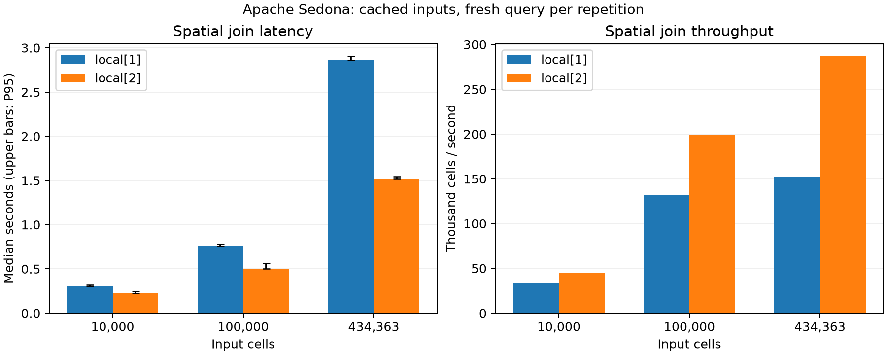

# Phase 1 Completion Report — Weeks 1–3

**Project:** India’s Urban Concentration and Emerging Growth Centres using GHSL  
**Date:** 7 November 2026  
**Status:** Completed pilot validation and benchmarks.

## 1. Scope

A validated foundation for all three GHSL products: population, built-up surface (total and non-residential), and settlement classification. The work covers the Bengaluru pilot across all ten historical observations from 1975 to 2020, plus 2025/2030 test observations. Existing source data were re-audited and reused. Apache Sedona now performs actual geospatial Spark operations, and quantitative benchmark definitions and measurements are supplied.

## 2. Validation results

| Requirement | Verified result |
| --- | --- |
| All-product coverage | 48 source archives: four raster components × 12 observations; 100% expected coverage |
| Source integrity | All cached archive SHA256 and ZIP CRC checks passed |
| Grid and value checks | All 48 clipped rasters checked for CRS, resolution, NoData, masks, valid categories and totals |
| Native/parent relationship | All product keys and parent domains agree; independently recomputed population, total built-up and NRES sums match every 1 km output cell over all 12 observations |
| Actual HDFS verification | Raw, cleaned and curated zones retrieved; 48 source archive hashes and 132 prepared/curated files matched |
| Apache Sedona | Spatial country coverage, district assignment and fine-cell-to-parent containment executed in Spark |
| Independent spatial validation | Every one of 434,363 pilot cells matched the separate Shapely district reference; zero missing/duplicate or mismatched assignments |
| Tests | Three phase-1 contract/metric tests passed; actual Sedona jobs independently passed on both worker settings |
| Performance evaluation | Three input sizes, one warmup and five measured repetitions per size, for local[1] and local[2] |

These spatial checks validate the pilot workload. The study area is a rectangle around Bengaluru, not a city administrative boundary.

## 3. Geospatial processing with Apache Sedona

Apache Sedona 1.9.1 runs with Spark 3.5.6, Scala 2.12.18 and Java 17.0.7. The pinned JVM artifacts and their published-checksum/local-SHA256 evidence are in `runtime/jar_manifest.json`.

Spatial SQL uses ST_Covers for point-in-polygon matching, ST_Point for native cell centres, ST_PolygonFromEnvelope for 1 km parents, and ST_Area for parent-area validation. Saved physical query plans must contain a Sedona spatial join operator. The output mapping is persisted and checked after reading it back. This is functional integration rather than installation alone.

Boundary geometries are projected with the established PyProj grid contract before Sedona processing. No new accuracy is implied by inheriting a 1 km settlement class at 100 m.

## 4. Quantitative performance evaluation

Protocol: benchmark.json was saved before measurements. Each workload uses cached inputs but recomputes and materializes the spatial join result. JVM startup and input/validation preparation are recorded separately. All runs use eight Spark partitions; only local worker count changes. Input sizes use deterministic spatially ordered subsets, not random samples. Results are workload-specific and are not extrapolated to India. No minimum speedup is assumed.

| Workers | Input cells | Median seconds | P95 seconds | Median cells/second | Peak sampled process-tree RSS (GB) |
| --- | ---: | ---: | ---: | ---: | ---: |
| local[1] | 10,000 | 0.300 | 0.315 | 33,384 | 1.755 |
| local[1] | 100,000 | 0.756 | 0.780 | 132,310 | 1.797 |
| local[1] | 434,363 | 2.858 | 2.904 | 151,964 | 2.066 |
| local[2] | 10,000 | 0.222 | 0.243 | 45,134 | 2.010 |
| local[2] | 100,000 | 0.503 | 0.561 | 198,742 | 2.068 |
| local[2] | 434,363 | 1.514 | 1.544 | 286,884 | 2.145 |

Single-worker median time divided by two-worker median time:

- 10,000 cells: 1.352×. Values below 1 mean two workers were slower for that workload.
- 100,000 cells: 1.502×. Values below 1 mean two workers were slower for that workload.
- 434,363 cells: 1.888×. Values below 1 mean two workers were slower for that workload.

Per-repetition JSON also records sampled CPU time, Spark task runtime/CPU time, JVM garbage collection, memory/disk spill and shuffle read/write bytes. Peak RSS is sampled every 100 ms and sums Python/JVM descendants; shared pages can be counted more than once. Five repetitions provide a small-sample P95 estimate, not a formal confidence interval.

Machine: macOS-26.7.1-x86_64-i386-64bit; 4 physical / 8 logical CPUs; 17.2 GB RAM. These are single-machine results, not multi-machine distributed scaling evidence.

Predeclared engineering targets for the full pilot join: median ≤120 s, throughput ≥3,500 cells/s, sampled process-tree RSS ≤8 GB. These are local engineering targets, not external standards. Correctness is a hard gate; performance target outcomes are reported below without changing the thresholds after measurement.

- local[1]: latency PASS; throughput PASS; sampled memory PASS.
- local[2]: latency PASS; throughput PASS; sampled memory PASS.

## 5. Storage verification measurements

| HDFS zone retrieved | Bytes | Wall seconds | MB/second |
| --- | ---: | ---: | ---: |
| raw | 636,114,415 | 6.40 | 99.41 |
| cleaned | 28,197,170 | 5.59 | 5.05 |
| curated | 64,523,927 | 3.73 | 17.29 |

These are single local-HDFS retrieval observations including command startup; they are not repeated cold-cache storage benchmarks. HDFS health passed with replication one. The audit stopped its own services and removed only its newly created verification copies; original data remain intact.

## 6. Scope and limitations

Official JRC native downloads substitute for the proposal’s Earth Engine exports. The source releases, grids and provenance are explicit; no Earth Engine authentication or export execution is claimed. This report therefore documents an acquisition-method deviation rather than presenting literal compliance with that step.

The fixed country boundary represents 2014 and the district boundary represents 2021. District polygons support spatial validation here, not reconstruction of historical administrative boundaries.

## 7. Reproduction and evidence

See README.md for commands and REPRODUCTION.md for the three-phase overview. Key evidence: reports/input_audit_run2/validation.json; reports/sedona_local1_run3/validation.json; reports/sedona_local2_run1/validation.json; saved physical plans and Spark event logs; reports/tests_contract_after_pandas.txt; config/benchmark.json.

The phase-1 ZIP includes clipped all-product pilot rasters/tables, source provenance, Sedona mapping outputs, code, configuration and reports. Large original source ZIPs, HDFS runtime, the Python environment and JVM binaries remain outside the package; dependency and source manifests identify them.

Sources: European Commission Joint Research Centre GHSL R2023A (POP/BUILT-S V1_0, SMOD V2_0); geoBoundaries gbOpen, district sources Pathways Data Pvt. Ltd. and lgdirectory.gov.in, ODbL 1.0. Preserve attribution when sharing derived data.

Apache Sedona setup: https://sedona.apache.org/1.9.1/setup/install-python/  
Spatial join documentation: https://sedona.apache.org/latest/api/sql/Optimizer/
