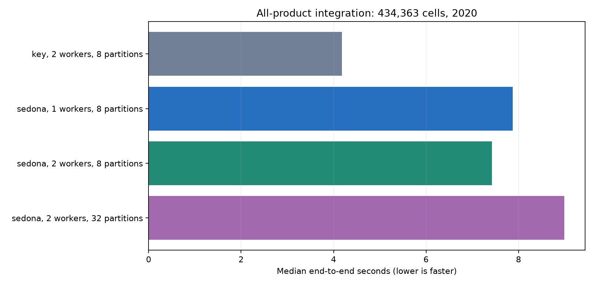

# Phase 2 completion report — weeks 4–5

India’s Urban Concentration and Emerging Growth Centres using GHSL  
7 November 2026

## Outcome

The reusable all-product Spark/Sedona pilot has executed successfully on HDFS across
all 12 epochs (1975–2030). Ten historical observations and two projection tests remain
separately labelled. Population, total built-up, non-residential built-up and
matching-year settlement class are available together for every valid native cell.

- 5,212,356 native 100 m records and 53,460 summed 1 km records.
- 0 rejected records; 0 incomplete trajectories in this pilot.
- HDFS pipeline, including validation: 171.61 seconds (single observation).
- HDFS health passed, outputs retrieved locally, owned services stopped.
- Independent Arrow comparison passed for every native, coarse and SQL-summary column.
- Three actual Sedona regression tests passed in 35.25 seconds.

## Implementation and evaluation

Apache Sedona 1.9.1 assigns native centres to matching-year SMOD parent
polygons. The physical-plan guard requires a Sedona spatial operator; plans are
retained alongside execution evidence. Spark handles ingestion, validation, native
product joining, sums, SQL summaries and partitioned Parquet persistence.

Explicit quantitative metrics were declared before measurement: median and descriptive
P95 latency, native rows/s, peak sampled process-tree RSS, CPU, task time, GC,
shuffle/spill bytes, output size, worker scaling and partition sensitivity.
Every trial must pass persisted-result equivalence regardless of its speed.

## End-to-end results

One real epoch (2020), all products, 434,363 native cells. One warmup and three
measured repetitions per scenario. Timer includes fresh reads, joins, aggregation and
writes of native, coarse and class-summary outputs. Startup and post-write correctness
checks are excluded. No cached DataFrames or reused result query; OS cache uncontrolled.

| Scenario | Median s | P95 s | Cells/s | Peak RSS GB | Targets passed |
|---|---:|---:|---:|---:|---|
| key, 2 workers, 8 partitions | 4.179 | 4.900 | 103,945 | 2.218 | True |
| sedona, 1 workers, 8 partitions | 7.876 | 8.401 | 55,152 | 2.235 | True |
| sedona, 2 workers, 8 partitions | 7.426 | 8.309 | 58,489 | 2.306 | True |
| sedona, 2 workers, 32 partitions | 8.990 | 9.551 | 48,315 | 2.574 | True |

Sedona one-to-two-worker time ratio: 1.061×. Sedona/key median time ratio at two workers and eight partitions: 1.777×. Using 32 instead of eight partitions changes Sedona median time by +21.1%. These observations apply only to this workload and machine; extra partitions can add scheduling overhead.

Targets: median ≤120 s, median throughput ≥3,500 cells/s and sampled RSS ≤8 GB.
These are local engineering thresholds, not claims of production cluster capacity.
Three repetitions give only a descriptive P95, not a stable tail-latency estimate.
RSS can double-count shared pages and miss peaks shorter than 100 ms.

## Scientific correctness and scope

Native population counts and built-area values are retained. One-kilometre values
are sums; missing values remain null and valid zero is preserved. Settlement is an
inherited 1 km category, not an independently measured 100 m classification.
Partial pilot cells are flagged without extrapolation. Keys, epochs, masks, input
ranges, unique assignments and conservation are checked before completion. Projections
are excluded from historical conclusions. Independent aggregate comparisons permit
rtol 1e-10 / atol 1e-5; Spark reread comparisons are exact and null-safe.

This validates a reusable pilot/bounded-workload implementation. India-wide execution
and analytical conclusions are phase 3 and are not established by this report.
Official JRC archive acquisition substitutes for Earth Engine exports. All executions
use local Spark and a single-node HDFS; no multi-machine speedup is claimed.
The key-join baseline remains useful for aligned regular grids. Sedona adds spatial
semantics and independently checked geometry; it is not assumed to beat key arithmetic.

## Reproduction

Read ../README.md for commands, schemas, paths and limitations. Detailed evidence:
`hdfs_validation.json`, `hdfs_execution.json`, `reference_comparison.json`,
`tests_run1.txt`, `benchmarks/*/validation.json`, event logs, physical plans and CSV.
The phase-2 handoff includes code, reports and validated curated data; use it with the
phase-1 handoff for staged inputs and environment restoration. Raw national sources,
installed binaries and duplicate benchmark output datasets are excluded. Archive CRC
and per-file SHA256 are verified separately in HANDOFF_VALIDATION.json.

Sedona optimizer reference: https://sedona.apache.org/latest/api/sql/Optimizer/
